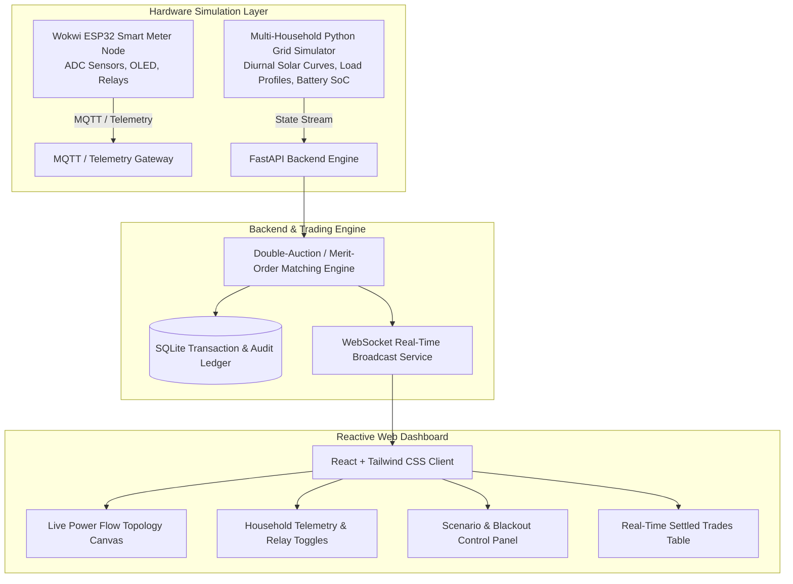

# Decentralized Solar Microgrid & Peer-to-Peer (P2P) Energy Sharing Platform

[](https://fastapi.tiangolo.com)
[](https://react.dev)
[](https://wokwi.com)
[](https://sdgs.un.org)

An end-to-end, full-stack community microgrid management platform and hardware simulation that enables residential prosumers and consumers to autonomously exchange surplus rooftop photovoltaic solar energy with neighbors during peak-demand periods or utility grid blackouts.

---

## 1. Project Overview & Societal Impact

* **The Problem:** In conventional residential power setups, households with rooftop solar panels export excess power back to the centralized utility grid at meager feed-in tariffs (e.g., $0.06/kWh), while immediate neighbors purchase power from the same utility company at elevated retail tariffs (e.g., $0.20/kWh). Furthermore, when central grid blackouts occur, traditional grids cut off distribution, leaving entire communities without power despite local solar generation capacity.
* **The Solution:** A decentralized, neighborhood-level peer-to-peer (P2P) energy trading grid where:
  1. Solar prosumers sell directly to neighbors at a mid-market clearing tariff ($0.13/kWh) — yielding **+116% higher revenue for sellers** and **35% lower electricity bills for buyers**.
  2. A shared **25 kWh Community Battery Buffer** absorbs surplus energy before grid export.
  3. The microgrid automatically **islands** during centralized power outages, ensuring critical community resilience.
  4. Aligned with **UN Sustainable Development Goals**:
     * **SDG 7:** Affordable and Clean Energy
     * **SDG 11:** Sustainable Cities and Resilient Communities

---

## 2. System Architecture



---

## 3. Mathematical Clearing & Settlement Model

### Market Tariffs
* **Utility Retail Import Rate ($P_{\text{utility}}$):** $\$0.20 \text{ / kWh}$
* **Utility Feed-in Export Rate ($P_{\text{feedin}}$):** $\$0.06 \text{ / kWh}$
* **P2P Mid-Market Clearing Price ($P_{\text{P2P}}$):**
  $$P_{\text{P2P}} = \frac{P_{\text{utility}} + P_{\text{feedin}}}{2} = \frac{0.20 + 0.06}{2} = \$0.13 \text{ / kWh}$$

### Economic Advantage
For every kilowatt-hour ($Q$) traded within the community:
* **Buyer Savings:** $Q \times (P_{\text{utility}} - P_{\text{P2P}}) = Q \times \$0.07 \text{ saved}$
* **Seller Extra Profit:** $Q \times (P_{\text{P2P}} - P_{\text{feedin}}) = Q \times \$0.07 \text{ extra revenue}$

---

## 4. Hardware Simulation Layer

### A. Wokwi ESP32 Smart Meter Node (`simulation/wokwi/`)
* **Microcontroller:** ESP32 DevKit v4
* **Sensors:**
  * Potentiometer 1 (Pin 34): Simulated Solar Inverter Current / Generation (0 to 6 kW)
  * Potentiometer 2 (Pin 35): Simulated Home Load Sensor (0.2 to 5 kW)
  * Potentiometer 3 (Pin 32): Battery State of Charge (20% to 100%)
* **Actuators:** Relays for Grid Tie-in / Islanding switch (Pin 18) and Battery controller (Pin 19)
* **Display:** I2C SSD1306 OLED (Pins 21, 22) displaying live Net Balance and relay state
* **Connectivity:** WiFi + MQTT client publishing JSON telemetry every 2 seconds

### B. Multi-Household Physics Simulator (`simulation/grid_simulator.py`)
Simulates 5 distinct neighborhood profiles:
1. **Alpha Villa (`house_alpha`):** High solar generation (6 kW PV array + 10 kWh home battery, hardware-linked to ESP32).
2. **Beta Eco-Home (`house_beta`):** Moderate solar generation (4 kW PV array, solar-only prosumer).
3. **Epsilon Smart-Home (`house_epsilon`):** Distributed prosumer (3.5 kW PV array + 5 kWh home battery).
4. **Gamma Residence (`house_gamma`):** Pure consumer family (0 kW PV, typical domestic load).
5. **Delta Family (`house_delta`):** High-demand consumer with Level 2 Electric Vehicle (EV) charger surges.
6. **Community Battery Hub:** Shared 25 kWh buffer for excess neighborhood solar absorption.

---

## 5. Quickstart Guide

### Prerequisites
* Python 3.10+
* Node.js v18+ and npm

### One-Click Launch (Windows)
Double-click `start.bat` or run in PowerShell:
```powershell
.\start.ps1
```

### Manual Launch
#### 1. Backend Server
```bash
cd backend
pip install -r requirements.txt
python -m uvicorn app.main:app --host 0.0.0.0 --port 8000 --reload
```
* API Documentation: [http://localhost:8000/docs](http://localhost:8000/docs)
* WebSocket Endpoint: `ws://localhost:8000/ws`

#### 2. Frontend UI Dashboard
```bash
cd frontend
npm install
npm run dev
```
* UI Dashboard: [http://localhost:5173](http://localhost:5173)

#### 3. Running Automated Test Suite
```bash
pytest -v
```
Runs 18 unit and integration tests covering the P2P bilateral matching engine, diurnal physics curves, battery safety limits, and FastAPI REST/WebSocket endpoints.

---

## 6. Live Demonstration Scenarios

In the web dashboard, use the **Microgrid Scenario & Simulation Controls** panel to trigger:
* **☀️ Peak Solar Noon:** Maximum rooftop irradiation; prosumers cover 100% of community demand and export excess into the community battery.
* **⛅ Cloudy Afternoon:** Irradiance fluctuates, testing real-time dynamic balance.
* **🌙 Night Grid Outage / Blackout:** External utility grid fails; the microgrid islands autonomously and draws from local batteries to keep homes powered.
* **Individual Household Islanding:** Click any household's **Cutoff** button to simulate physical relay disconnection and observe the network rebalance automatically.
